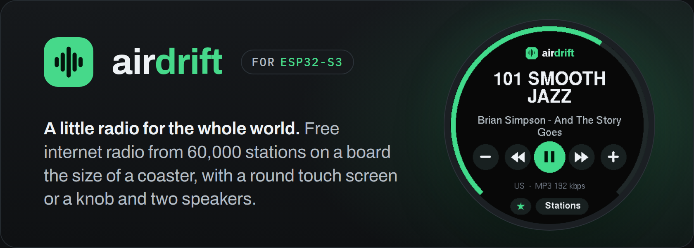
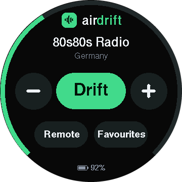
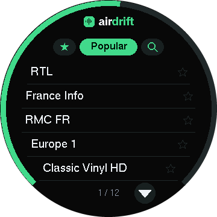
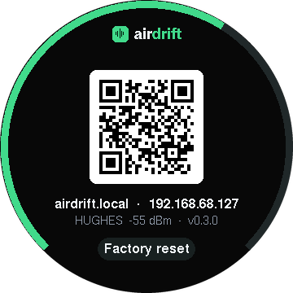
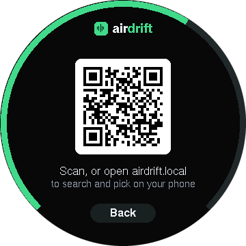
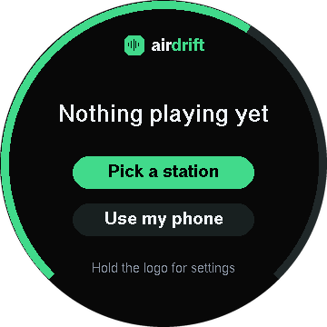
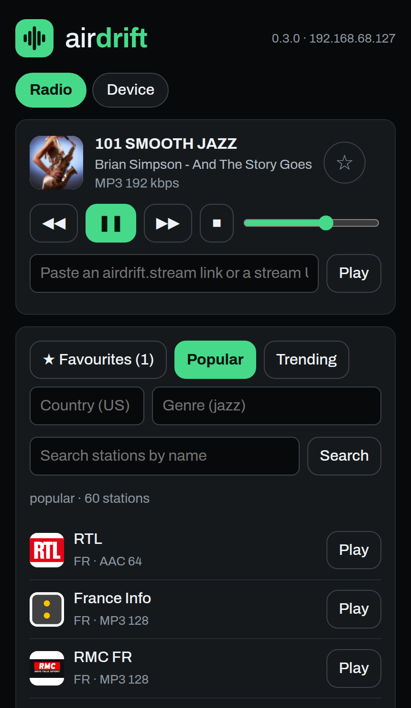
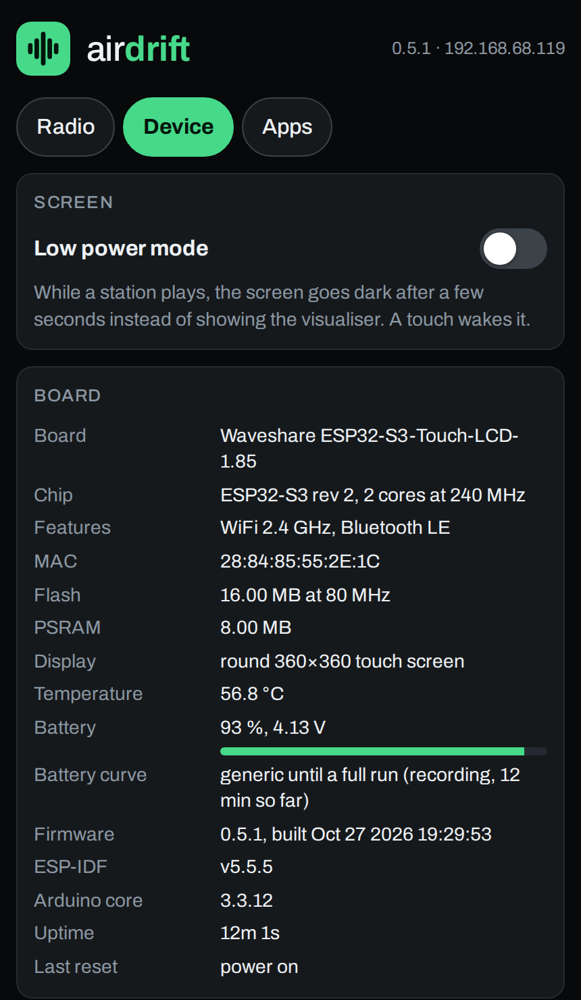

<p align="center">
  <a href="https://airdrift.stream"></a>
</p>

<h1 align="center">Air Drift for ESP32-S3</h1>

<p align="center">
  <strong>A little radio for the whole world.</strong><br>
  Firmware that turns an ESP32-S3 board into an internet radio playing the 60,000 stations of
  <a href="https://airdrift.stream">airdrift.stream</a>: on a Waveshare board with a round touch screen,
  or on a dev board with a knob, two speakers and some soldering.
</p>

<p align="center">
  <a href="LICENSE"></a>
  <a href="https://airdrift.stream"></a>
  <a href="https://platformio.org"></a>
  <a href="#the-two-radios"></a>
</p>

---

Plug a speaker into a £20 board, give it your WiFi, and it plays live radio
from almost every country on earth. No account, no app, no subscription: the
stations come from [Air Drift](https://airdrift.stream), a free directory of
internet radio, and play straight from their own streams.

The radio has its own web page on your network for searching and picking
stations from a phone or laptop, remembers what it was playing, saves
favourites to flash, and updates its own firmware over WiFi.

<p align="center">
  &nbsp;&nbsp;
  &nbsp;&nbsp;
  
</p>

## Contents

- [What you get](#what-you-get)
- [The two radios](#the-two-radios)
- [Quick start](#quick-start)
- [The screen](#the-screen)
- [The web page](#the-web-page)
- [First boot](#first-boot)
- [Updating the firmware](#updating-the-firmware)
- [The custom build](#the-custom-build)
- [Build and flash](#build-and-flash)
- [Serial console](#serial-console)
- [API](#api)
- [How it fits Air Drift](#how-it-fits-air-drift)
- [Development](#development)
- [Contributing](#contributing)
- [Air Drift everywhere else](#air-drift-everywhere-else)
- [Credits](#credits)
- [Use at your own risk](#use-at-your-own-risk)
- [Licence](#licence)

## What you get

- **60,000 stations**, the [Air Drift](https://airdrift.stream) directory:
  Popular and Trending lists, every country, 160 genres, and search by name.
  The lists come as single static files from the site, so browsing costs one
  request and playing costs none.
- **Any stream.** Paste an `airdrift.stream/listen/…` link or a plain stream
  URL on the web page. MP3, AAC and HLS, plus FLAC, Opus and Vorbis through
  the decoder library.
- **Now playing** from the stream's own title, on the screen and on the page.
- **Favourites** saved to flash: a star on the screen, on the page, and at the
  end of every list row.
- **A touch screen that does the whole job** on the Waveshare board: pick a
  station, save it, change the volume, see what is on. Nothing else is needed
  once it is online.
- **A branded web page** at `http://airdrift.local` with the lists, search,
  transport, volume and favourites, and a **Device** tab with the board, memory,
  WiFi signal, CPU load per core, chip temperature, the audio pipeline and the
  task list.
- **WiFi setup from a phone**: the screen shows a QR code, the phone joins the
  radio's setup network, and an Air Drift setup page opens by itself, like
  hotel WiFi.
- **Firmware updates over WiFi** from the Device tab, or with one script.
- **Remembers** the last station and volume and resumes after a power cut;
  **reconnects** a dropped stream on its own.
- **A serial console** for anyone who prefers typing, and a JSON API for
  everyone else: Home Assistant, a shortcut on a phone, a cron job.
- **Private.** No account, no telemetry. The radio talks to airdrift.stream
  for lists, to Radio Browser for search and play counts, and to the station
  you are listening to.

## The two radios

One codebase, two PlatformIO environments.

| | **The self-contained unit** | **The custom build** |
|---|---|---|
| Env | `waveshare-185` | `devkit` (`devkit-quad` for quad PSRAM) |
| Board | [Waveshare ESP32-S3-Touch-LCD-1.85](https://www.waveshare.com/wiki/ESP32-S3-Touch-LCD-1.85), either revision | ESP32-S3-DevKitC-1 with PSRAM (N16R8 is the usual one) |
| Sound | the board's own codec and amplifier; plug a speaker into its header | a PCM5102A DAC into a TPA3116D2 amplifier and two speakers |
| Controls | the round 360×360 touch screen | a rotary encoder (volume, push for play/pause) and two buttons |
| Setup | by QR code on the screen | from the serial console, or the same setup network |
| Soldering | none | yes, see [The custom build](#the-custom-build) |

Both are driven the same way from the web page, the console and the API, and
both play the same stations.

## Quick start

**Nothing to build.** Every release on the
[Releases page](https://github.com/Air-Drift/ESP32-S3/releases) has a
ready-made image for each board, and the newest is always at the same
address. For the Waveshare board, plug it in by USB and write it at address 0
with [esptool](https://docs.espressif.com/projects/esptool/):

```bash
pip install esptool
curl -LO https://github.com/Air-Drift/ESP32-S3/releases/latest/download/airdrift-waveshare-185-full.bin
esptool --chip esp32s3 --baud 921600 write-flash 0x0 airdrift-waveshare-185-full.bin
```

That one file holds the bootloader, the partition table and the firmware, so
it works on a board that has never seen Air Drift. It is a fresh start: a
radio that already had WiFi forgets it (favourites survive), which is why a
radio that is already running Air Drift updates from its Device tab instead.
When the screen lights up,
follow it: scan the QR code with your phone, pick your WiFi, done. From then
on the radio is at **http://airdrift.local** on your network and on its own
screen, and later releases install from its Device tab without a cable.

For the custom build, the same with `airdrift-devkit-full.bin`
(or `airdrift-devkit-quad-full.bin` for a board with quad PSRAM), then see
[First boot](#first-boot). To build from source instead, see
[Build and flash](#build-and-flash).

## The screen

The Waveshare board's round screen is the whole interface. It draws in Air
Drift's own palette, with a volume ring around the edge.

<table>
  <tr>
    <td width="33%" align="center"></td>
    <td width="33%" align="center"></td>
    <td width="33%" align="center"></td>
  </tr>
  <tr>
    <td><strong>Home.</strong> The station, the song, volume down and up, previous, play/pause, next. The star saves the station; Stations opens the list. Swipe left or right for the next or previous station, up for the list.</td>
    <td><strong>Stations.</strong> Three pills, always the same three: Favourites, Popular and Search. Tap a row to play it, its star to save it, the arrows to page. A country or genre loaded from the web page shows here too.</td>
    <td><strong>Search.</strong> Searching needs a keyboard, so the magnifier hands over to the web page with a QR code. Pick a station there and the screen goes home with it.</td>
  </tr>
  <tr>
    <td align="center"></td>
    <td align="center"></td>
    <td align="center"></td>
  </tr>
  <tr>
    <td><strong>Nothing playing yet.</strong> The first thing a new radio shows once it is online: pick from the Popular list here, or use a phone.</td>
    <td><strong>Let's get you online.</strong> With no WiFi stored, a QR code that joins the radio's setup network. See <a href="#first-boot">First boot</a>.</td>
    <td><strong>Hold the logo</strong> for the connect screen: the page's QR code, hostname and IP, WiFi network and signal, firmware version, and <strong>Factory reset</strong> (tap it twice).</td>
  </tr>
</table>

Volume buttons repeat while held. A tap on the logo always leads home. The
BOOT button on the board is play/pause too.

## The web page

Every radio serves its own page at `http://airdrift.local` (or its IP),
styled like the site, light or dark with the phone. Station logos load in
the browser from their own hosts, never through the radio.

<table>
  <tr>
    <td width="50%" align="center"></td>
    <td width="50%" align="center"></td>
  </tr>
  <tr>
    <td><strong>Radio.</strong> What is playing with its logo, play/pause, previous, next, stop, volume, a box for any link or stream, then Favourites, Popular, Trending, a country, a genre, and search. Stations without a logo get their initials on a tint, as on the site.</td>
    <td><strong>Device.</strong> Board and chip, CPU load per core, memory with low-water marks, WiFi signal and addresses, the audio pipeline with its stream buffer, every FreeRTOS task, a screenshot of the screen, and the firmware update.</td>
  </tr>
</table>

The page is plain HTML and JavaScript served from flash: one file, no build
step, no framework. Anything it does, the [API](#api) does too.

## First boot

**The Waveshare unit** walks you through it on its screen:

1. With no WiFi stored it shows **Let's get you online** and a QR code. Scan
   it with a phone to join the *Air Drift Setup* network (or join it from WiFi
   settings), and the setup page opens by itself. It lists the networks in
   range, strongest first; pick yours, type the password, **Connect**. The
   screen says "Joining…", then the setup network switches itself off.
2. Once online it offers two ways in: **Pick a station** opens the Popular
   list on the screen; **Use my phone** shows a QR code for the radio's own
   web page, with the address in words (`airdrift.local`).
3. Hold the logo at any time for the connect screen, with the page's QR code
   and a **Factory reset** that forgets WiFi, favourites and the last station
   and starts over at step 1, for moving house or handing it on.

**The custom build** has no screen, so:

1. Open the serial monitor (`pio device monitor`, 115200). The radio prints
   its state; type `help`.
2. Give it WiFi: join the *Air Drift Setup* network from a phone and pick your
   network on the page that opens, or type `wifi <ssid> <password>` (quote a
   name with spaces).
3. It prints its address. Open **http://airdrift.local** on a phone or laptop
   on the same network and pick a station.

With a bare dev board and no DAC wired, everything except the sound works:
the lists load, the stream opens, the titles print.

## Updating the firmware

The radio updates itself. Open its page, **Device** tab: it asks the
[Releases page](https://github.com/Air-Drift/ESP32-S3/releases) what the
newest version is and, if that is newer than what it runs, offers
**Install it**. The radio downloads the firmware straight from GitHub, shows
the progress on its screen, writes it to its spare app partition, checks it
and restarts on it; the page reconnects when it is back. About a minute in
all. Keep the power on. On the console, `update` checks and `update now`
installs.

The same tab takes an upload of your own build (`firmware.bin`, which
PlatformIO leaves in `.pio/build/<env>/`, or a release's
`airdrift-<board>.bin`).

From a shell, one step:

```bash
scripts/ota.sh waveshare-185            # build and send to airdrift.local
scripts/ota.sh devkit 192.168.1.50      # or to an address
```

Over USB, `scripts/flash.sh` still works and also resets the boot selector
to the first partition.

**Releases** are built by GitHub Actions: a push to `main` that touches the
firmware, with a new version in `include/config.h`, builds every board and
publishes the images under a `v<version>` tag. A change to the README, or
code without a version bump, builds nothing. `scripts/release-images.sh`
makes the same images locally in `dist/`.

## The custom build

An ESP32-S3 dev board, a PCM5102A DAC, a TPA3116D2 amplifier and two small
speakers, all fed from one USB-C PD charger.

| Part | Notes |
|---|---|
| ESP32-S3 dev board **with PSRAM** | The decoder refuses to start without PSRAM. N16R8 (16 MB flash, 8 MB octal PSRAM) is the common one; N8R2 also works with the `devkit-quad` build. |
| PCM5102A DAC (GY-PCM5102) | I2S in, stereo line out. |
| TPA3116D2 amplifier board | Takes the DAC's line out; 12–24 V supply; its own volume pots. |
| Two 4 Ω speakers | 78 mm, 15 W. |
| USB-C PD trigger board, set to 20 V | Pulls 20 V from a 30 W PD charger for the amplifier. |
| MP1584EN buck converter, trimmed to 5 V | Feeds the ESP32 from the same 20 V. |
| EC11 rotary encoder with push switch | Volume, and play/pause on the push. |
| Two tact switches | Next and previous. |
| Later: 3.5" ILI9488 touch display | GPIO 8–14 are kept free for it. |

A MAX98357A (DAC and 3 W mono amp in one, speaker wired straight to it) is
the simpler alternative: the same three I2S wires, no amplifier board.

### Wiring

Defaults in `include/config.h`; any free GPIO works on the S3, but avoid the
strapping pins (0, 3, 45, 46) and the USB pins (19, 20).

| PCM5102A pin | ESP32-S3 pin | `config.h` |
|---|---|---|
| BCK | GPIO 5 | `PIN_I2S_BCLK` |
| LCK | GPIO 6 | `PIN_I2S_LRC` |
| DIN | GPIO 7 | `PIN_I2S_DOUT` |
| SCK | GND | |
| VIN | 5V (3V3 also works) | |
| GND | GND | |

The GY-PCM5102 has four solder jumpers on the back and stays muted until
they are set: 1 = L, 2 = L, **3 = H**, 4 = L. Many ship unset.

DAC line out (L, GND, R) to the amplifier's input header, speakers on the
amplifier's L and R terminals, and the amplifier's power terminals on the
20 V from the PD trigger. The buck converter takes the same 20 V down to 5 V
for the ESP32's 5V pin; set it with a meter before connecting the board.
All grounds are common.

| Control | ESP32-S3 pin | `config.h` |
|---|---|---|
| Encoder A | GPIO 15 | `PIN_ENC_A` |
| Encoder B | GPIO 16 | `PIN_ENC_B` |
| Encoder common (middle of the three) | GND | |
| Encoder push switch | GPIO 17 | `PIN_BTN_PLAY` (play / pause) |
| Encoder switch, other side | GND | |
| Next button | GPIO 18 to GND | `PIN_BTN_NEXT` |
| Previous button | GPIO 4 to GND | `PIN_BTN_PREV` |

Internal pull-ups, no resistors.

## Build and flash

[PlatformIO](https://platformio.org) does everything, on the
[pioarduino](https://github.com/pioarduino/platform-espressif32) platform so
the Arduino core is 3.x, which the audio library needs.

| Env | Board |
|---|---|
| `waveshare-185` | Waveshare ESP32-S3-Touch-LCD-1.85 and 1.85C |
| `devkit` (default) | DevKitC with octal PSRAM: N16R8, N8R8 |
| `devkit-quad` | DevKitC with quad PSRAM: N8R2, N4R2 |

```bash
scripts/flash.sh waveshare-185 [/dev/ttyACM0]   # build, verify the image, flash over USB
scripts/ota.sh waveshare-185 [airdrift.local]   # build, verify, send over WiFi
pio run -e devkit                               # just build
pio device monitor                              # the serial console, 115200
```

To find out which PSRAM a DevKitC has, read the `Embedded PSRAM` line of
`pio pkg exec -- esptool.py --port /dev/ttyACM0 flash_id`. With the wrong env
the radio boots but prints `no PSRAM`.

**Linux** needs permission on the serial port once: copy
`udev/99-airdrift-esp32.rules` to `/etc/udev/rules.d/` and run
`sudo udevadm control --reload-rules && sudo udevadm trigger`, or add
yourself to the `dialout` group and log in again.

**If `pio run` fails** with a Python `AttributeError` or `TypeError` from
inside PlatformIO itself, run it again: PlatformIO 6.2 has an intermittent
fault in its library builder, and the scripts already retry. The image it
writes can also come out with a bad checksum, so the scripts rebuild it from
the ELF and check it with esptool before flashing.

The Waveshare board has two revisions and the firmware tells them apart at
boot by what answers on the I2C bus:

| | DAC | Amplifier enable | Touch bus |
|---|---|---|---|
| 1.85 | PCM5101, plain I2S | always on | its own (GPIO 1/3) |
| 1.85C | ES8311 codec at 0x18, needs register setup and MCLK | GPIO 15 | the system bus (GPIO 10/11) |

## Serial console

```
wifi <ssid> <password>   join a network
forget                   erase WiFi and restart into setup
factory                  erase WiFi, favourites and the last station, then restart
popular | trending       load that list from airdrift.stream
favourites               load the saved stations
country <CC>             load a country, e.g. country GB
genre <name>             load a genre, e.g. genre jazz
search <words>           search stations by name
list                     show the loaded list
play <n>                 play station n from the list
play <air drift link>    play a shared https://airdrift.stream/listen/... link
play <stream url>        play any stream
next | prev | pause | stop
vol <0-21>
fav                      save or unsave the playing station
resample on|off          48 kHz output through the library's resampler (off: it falls behind)
core 0|1                 which CPU core decodes
debug on|off             show the decoder's own messages
update [now]             check the project's releases for a newer firmware; now installs it
screen                   the screen as a BMP in base64, between marker lines
ui <name>                show a screen for a screenshot: home empty list about phone setup busy; ui off
status | help | reboot
```

## API

Everything the page does is a plain HTTP call, so anything on the network can
drive the radio: a Home Assistant `rest_command`, a shortcut on a phone, a
button on a desk.

| Call | Does |
|---|---|
| `GET /api/state` | playing, station, title, codec, volume, favourite, list source |
| `GET /api/list` | the loaded list |
| `GET /api/load?source=popular` | load a list: `favourites`, `popular`, `trending`, `country:US`, `tag:jazz` |
| `GET /api/search?q=words` | search by name |
| `GET /api/play?i=3` | play the n-th station of the loaded list |
| `GET /api/play?link=…` | play a shared `airdrift.stream/listen/<id>` link, or any stream URL |
| `GET /api/stop`, `/api/pause`, `/api/next`, `/api/prev` | transport (`pause` toggles) |
| `GET /api/volume?v=0..21` | volume |
| `GET /api/fav` | save or unsave the playing station |
| `GET /api/device` | board, chip, memory, WiFi, CPU load per core, audio pipeline, task list |
| `GET /api/update/check` | the newest release's version, and whether it is newer than this |
| `GET /api/update/install` | download the newest release from GitHub and restart on it |
| `POST /api/update` | the firmware image as a multipart file field: `curl -F firmware=@firmware.bin` |
| `GET /screen.bmp` | the screen right now (boards with a screen) |

```bash
curl "http://airdrift.local/api/load?source=tag:jazz"
curl "http://airdrift.local/api/play?i=0"
curl "http://airdrift.local/api/volume?v=10"
```

## How it fits Air Drift

The radio is a client of the site, nothing more: no servers of its own.

| On the site | On the radio |
|---|---|
| `data/v1/popular.json`, `trending.json` | the Popular and Trending lists |
| `data/v1/country/XX.head.json` | one country, first page of stations |
| `data/v1/index.json` + `data/v1/tag/<file>.head.json` | one genre |
| live search on Radio Browser | search |
| `/listen/<id>` links | paste to play |
| play report to Radio Browser | sent on every play, so what the radio plays counts in the rankings (`REPORT_PLAYS` turns it off) |
| ICY stream title | "now playing" |
| `css/app.css` palette, `icons/icon.svg` | the screen's and the page's colours and logo |

The radio keeps at most `MAX_STATIONS` (60) of any list in RAM, fetches only
when asked, and is one request per list and none while playing.

## Development

```
platformio.ini                 boards, envs, libraries
include/config.h               pins and defaults, per board
src/main.cpp                   boot and the main loop
src/net.*                      WiFi, the setup portal, mDNS
src/directory.*                the station lists, search, links, play reports
src/player.*                   the decoder and I2S output, on its own task
src/display.*                  the Waveshare screen and touch (empty on the devkit)
src/boards/es8311.h            the 1.85C's codec bring-up
src/boards/waveshare185_init.h the panel's init table
src/webui.*                    the web page and JSON API, firmware upload
src/updater.*                  firmware from the project's releases, on request
src/console.*                  serial commands
src/controls.*                 buttons and encoder
src/favourites.*               saved stations, in LittleFS
src/devinfo.*                  what the Device tab shows
src/icons.h                    the page's icons, from the site
docs/                          banner, screenshots, fonts for the banner
scripts/flash.sh               build, re-image and flash over USB
scripts/ota.sh                 build and send over WiFi
udev/                          serial port permissions for Linux
```

**How the screen is driven.** ESP-IDF's `esp_lcd` SPI panel IO in quad mode,
the way Waveshare's own demo does it (the Arduino_GFX QSPI bus garbles this
panel). Drawing goes into an Arduino_GFX canvas in PSRAM for its fonts and
shapes, and the frame is pushed in row chunks through internal DMA buffers
whenever something changes. Touch is a CST816; the firmware polls it while a
finger is down because its interrupt line goes quiet under a still finger.

**How the audio stays smooth.** Opening a stream, the play report, and the
decoder all run off the main loop, which only draws, reads the touch and
answers the web page. Streams play at their own sample rate: the library's
resampler falls behind real time (`resample on` to hear it).

**Screenshots** in this README are the real thing: `GET /screen.bmp` returns
the framebuffer, and the console's `ui <name>` shows any screen on demand, so
`ui setup` captures the setup screen without forgetting the WiFi. The
`screen` command prints the same image in base64 over USB for when there is
no WiFi at all. `docs/banner.html` is the banner, rendered with headless
Chromium.

Libraries: [ESP32-audioI2S](https://github.com/schreibfaul1/ESP32-audioI2S)
(decoding and I2S), [ArduinoJson](https://arduinojson.org),
[WiFiManager](https://github.com/tzapu/WiFiManager) (the access point and
captive portal; the pages are Air Drift's own), and for the screen
[Arduino_GFX](https://github.com/moononournation/Arduino_GFX) with
[U8g2](https://github.com/olikraus/u8g2)'s fonts and
[QRCode](https://github.com/ricmoo/QRCode).

### Roadmap

- The custom build's 3.5" ILI9488 touch display (SPI, FT6236 touch).
- A case for the custom build, and a board layout once the parts are settled.
- A "play on my radio" hand-off from the site, if the site ever gains a way
  to reach a device on the LAN.

## Contributing

Found a bug, or want to add something? Pull requests are welcome.

- **Fixes and features:** fork the repository, make the change on a branch and
  open a pull request against `main`. Both envs should still build
  (`pio run -e waveshare-185 && pio run -e devkit`).
- **Bugs you cannot fix yourself:**
  [open an issue](https://github.com/Air-Drift/ESP32-S3/issues) with the
  board, the firmware version from the Device tab, and what the serial
  console printed.
- **Other boards:** a port to another ESP32-S3 board with a screen or a DAC
  is mostly a new block in `include/config.h` and, for a screen, an init
  table in `src/boards/`. A pull request that adds one is very welcome.

Contributions are accepted under the project's [MIT licence](LICENSE).

## Air Drift everywhere else

[**Air Drift**](https://airdrift.stream) is a free internet radio player: a
globe of more than 60,000 live stations, no account, no adverts of its own.
The same stations that are on this radio are available on:

| | |
|---|---|
| **Web** | [airdrift.stream](https://airdrift.stream), in any browser, installable as an app |
| **iPhone, iPad, Apple TV, Apple Watch, CarPlay** | [Air Drift on the App Store](https://apps.apple.com/app/air-drift/id6816224999) |
| **Android, Android Auto, Android TV** | [airdrift.stream/apps](https://airdrift.stream/apps) |
| **Amazon Fire TV and Fire tablets** | [Air Drift on the Amazon Appstore](https://www.amazon.com/dp/B0HLWTBVX2) |
| **Amazon Alexa and Echo** | ["Alexa, open Air Drift"](https://www.amazon.com/dp/B0HM3JP6ZF) |
| **Windows** | [Air Drift on the Microsoft Store](https://apps.microsoft.com/detail/9NK2V8WTBJLG) |
| **Bose SoundTouch speakers** | [Air Drift for SoundTouch](https://github.com/Air-Drift/Sound-Touch), the preset buttons playing again |

All of them are listed at [airdrift.stream/apps](https://airdrift.stream/apps).

## Credits

- [ESP32-audioI2S](https://github.com/schreibfaul1/ESP32-audioI2S) by
  Wolle, which does the hard part: every codec, over the network, on a
  microcontroller.
- [Radio Browser](https://www.radio-browser.info/), the community directory
  that Air Drift's lists are built from.
- Waveshare, for the
  [ESP32-S3-Touch-LCD-1.85 wiki and demos](https://www.waveshare.com/wiki/ESP32-S3-Touch-LCD-1.85),
  where the panel's init sequence and the codec's registers come from.
- [tzapu's WiFiManager](https://github.com/tzapu/WiFiManager),
  [ArduinoJson](https://arduinojson.org),
  [Arduino_GFX](https://github.com/moononournation/Arduino_GFX),
  [U8g2](https://github.com/olikraus/u8g2) and
  [QRCode](https://github.com/ricmoo/QRCode).

## Use at your own risk

This software is provided as is, with no warranty of any kind. It drives
hardware: a speaker amplifier, a display, and on the custom build a 20 V
supply you wire yourself. It has been written with care, but you run it at
your own risk: the authors accept no liability for any damage, loss of
settings, loss of service or other harm that comes from using it, or from
building the hardware described here. Check your wiring with a meter before
you power it. The full terms are in the [licence](LICENSE).

## Licence

The code is released under the [MIT licence](LICENSE): use it, change it and
share it freely, with no warranty and no liability on the authors.

The licence covers the code, not the brand. The Air Drift name, logo and
wordmark are trademarks of the Air Drift project, with all rights reserved:
you may build and run this firmware with its branding as it comes, but a
modified version that you publish needs its own name and mark. The terms are
in [TRADEMARKS.md](TRADEMARKS.md).

The fonts in `docs/fonts` are Archivo and IBM Plex Mono, under the SIL Open
Font Licence (included beside them); they are only used to draw the banner.

Air Drift for ESP32-S3 is an independent project. It is not affiliated with,
endorsed by or supported by Waveshare or Espressif. Their names are used only
to say what this firmware runs on.

<p align="center">
  <a href="https://airdrift.stream"></a><br>
  <sub>Made by <a href="https://airdrift.stream">Air Drift</a>, free internet radio from everywhere.</sub>
</p>
